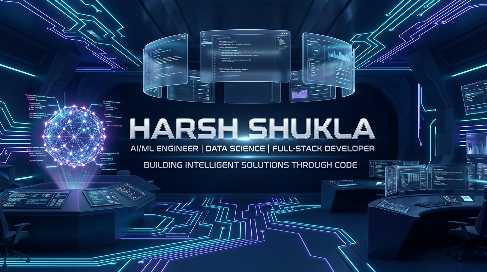
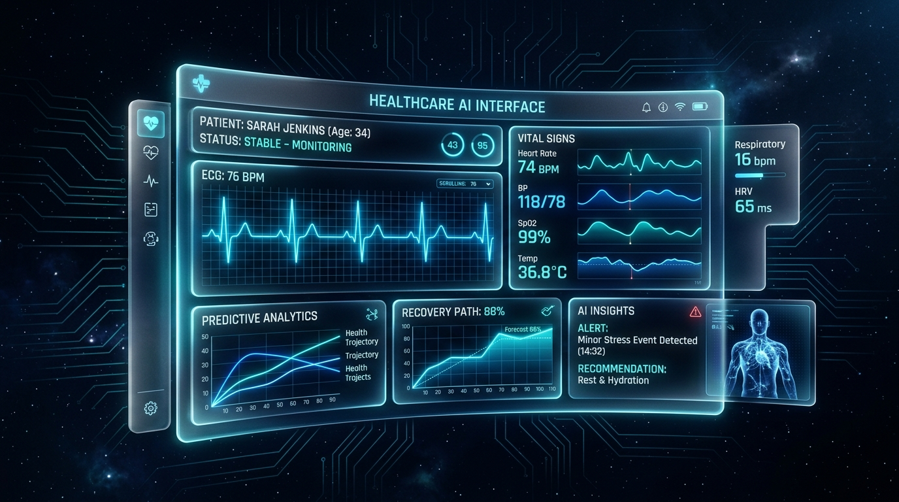
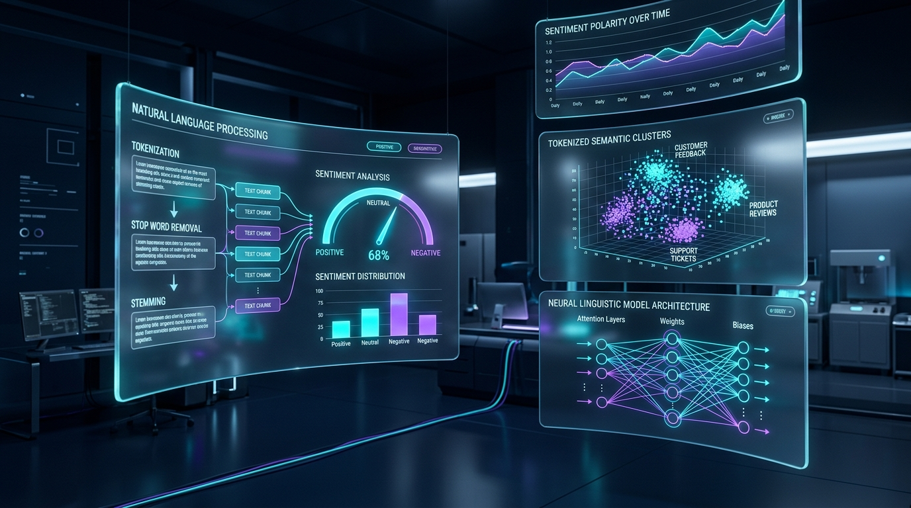
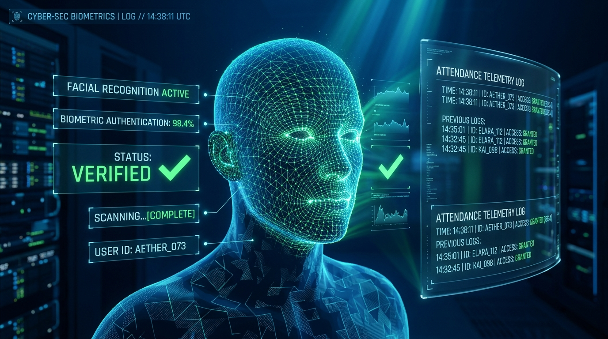
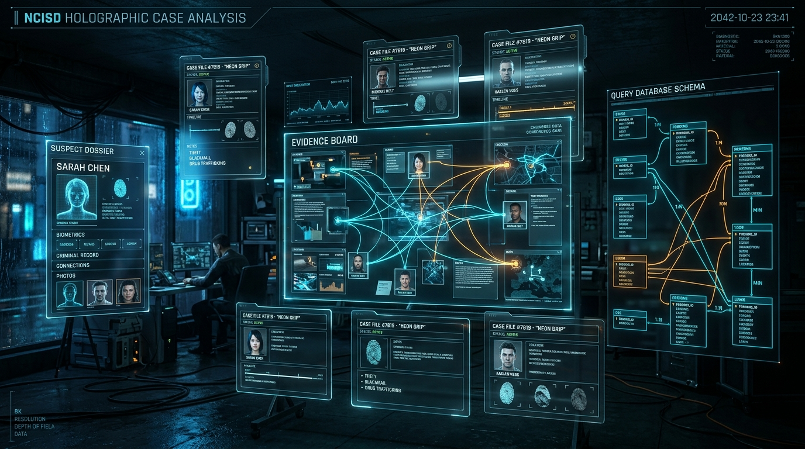
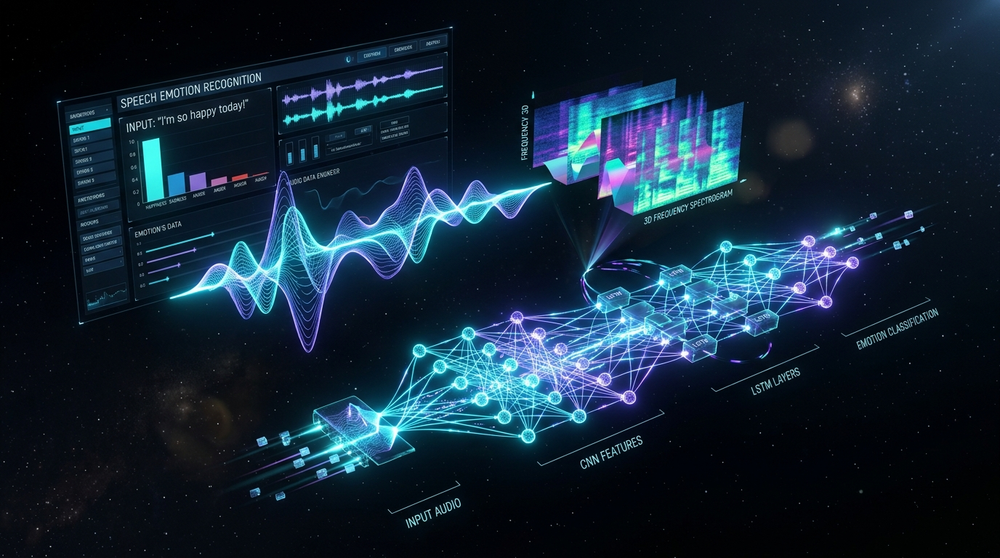

<div align="center">

<!-- 3D FUTURISTIC PROFILE BANNER -->


<br/><br/>

<!-- ANIMATED 3D HOLOGRAPHIC TYPING INTRO -->
<a href="https://harsh-portfolio-dp6i.onrender.com">
  
</a>

<br/>

<!-- HOLOGRAPHIC NAVIGATION & CONTACT BADGES -->
<p align="center">
  <a href="https://harsh-portfolio-dp6i.onrender.com" target="_blank">
    
  </a>
  <a href="https://www.linkedin.com/in/harshshukla110724/" target="_blank">
    
  </a>
  <a href="https://github.com/Harshshukla49" target="_blank">
    
  </a>
  <a href="https://leetcode.com/u/harshshukla_4321/" target="_blank">
    
  </a>
  <a href="mailto:shuklaharsh0207@gmail.com" target="_blank">
    
  </a>
</p>

</div>

---

### 🧬 About Me — AI & Code Universe

```
┌─────────────────────────────────────────────────────────────────────────────┐
│ 🧠 CORE IDENTITY: AI/ML Engineer · Data Scientist · Full-Stack Developer    │
│ 📍 LOCATION: India · United Institute of Technology (AKTU)                 │
│ 🎯 TARGET ROLES: AI Engineering · Data Science · Full-Stack Software Eng   │
└─────────────────────────────────────────────────────────────────────────────┘
```

- 🎓 **Academic Foundation:** B.Tech in Computer Science specializing in **Artificial Intelligence & Machine Learning** at **United Institute of Technology** (Dr. APJ Abdul Kalam Technical University, 2023–2027).
- 🔬 **AI & Deep Learning Practitioner:** Designing, training, and evaluating intelligent pipelines across **Computer Vision (OpenCV)**, **Speech Emotion Recognition (CNN, RNN, LSTM)**, and **Natural Language Processing (Scikit-Learn, NLTK)**.
- ⚙️ **Production Full-Stack Engineering:** Bridging machine learning with interactive software systems using **React.js**, **Node.js**, **Express.js**, **Flask**, and query-optimized database architectures (**SQLite**, **MongoDB**, **MySQL**, **Firebase**, **Supabase**).
- 🚀 **Real-World Impact:** Driven by measurable engineering outcomes—from achieving 90% facial recognition accuracy with an 85% reduction in manual effort to improving NLP classification accuracy by 12% on real Twitter datasets.
- 🤝 **Collaboration & Problem Solving:** Active competitor in collegiate ideathons and university sports (volleyball), bringing strong leadership, communication, and systematic problem-solving to high-performance development teams.

---

### ⚡ Futuristic Technology Stack

<div align="center">

<table>
  <thead>
    <tr bgcolor="#0B0F19">
      <th width="30%" align="left"><b>Domain Layer</b></th>
      <th width="70%" align="left"><b>Core Technologies & Tools</b></th>
    </tr>
  </thead>
  <tbody>
    <tr>
      <td><b>💻 Programming Languages</b></td>
      <td>
        
        
        
        
      </td>
    </tr>
    <tr>
      <td><b>🧠 AI & Data Science</b></td>
      <td>
        
        
        
        
        
        
        
      </td>
    </tr>
    <tr>
      <td><b>🎨 Frontend Architecture</b></td>
      <td>
        
        
        
        
      </td>
    </tr>
    <tr>
      <td><b>⚙️ Backend & APIs</b></td>
      <td>
        
        
        
        
      </td>
    </tr>
    <tr>
      <td><b>🗄️ Databases & Cloud</b></td>
      <td>
        
        
        
        
        
      </td>
    </tr>
    <tr>
      <td><b>🛠️ Developer Tools</b></td>
      <td>
        
        
        
        
      </td>
    </tr>
    <tr>
      <td><b>📐 Core CS Foundations</b></td>
      <td>
        
        
        
        
      </td>
    </tr>
  </tbody>
</table>

</div>

---

### 🛸 3D-Inspired Project Gallery

Each project represents a distinct technical vector in my engineering portfolio, combining theoretical AI models with production-ready software systems.

---

#### 🌌 01 · Smart Healthcare Remote Monitoring System
<div align="center">
  
</div>

- **Domain:** AI-Driven Medical Telemetry & Full-Stack Cloud Architecture
- **Tech Stack:** `React.js` • `Node.js` • `Firebase` • `Machine Learning`
- **Architecture Overview:** Full-stack healthcare monitoring platform engineering continuous patient biometric telemetry tracking with predictive health risk alerts.
- **Key Technical Contribution:** Built specialized doctor and patient portals featuring real-time biometric visualization streams connected to a machine learning prediction pipeline for early trend detection.
- **Project Access:** [🔗 Live Web Application](https://smart-health-rontend.onrender.com) | [💻 GitHub Repository](https://github.com/Harshshukla49/Smart_Health_Care)

---

#### 🌌 02 · Twitter Sentiment Analysis Platform
<div align="center">
  
</div>

- **Domain:** Natural Language Processing & Real-Time Data Science
- **Tech Stack:** `Python` • `NLP` • `Scikit-learn` • `NLTK` • `Streamlit`
- **Architecture Overview:** End-to-end sentiment classification engine ingesting live tweets via the Twitter API to extract opinion polarity.
- **Key Technical Contribution:** Processed **1,000+ live tweets**, implemented tokenization and stop-word vectorization pipelines, and achieved a **12% improvement in sentiment classification accuracy** over baseline models, deployed with an interactive Streamlit UI.
- **Project Access:** [💻 GitHub Repository](https://github.com/Harshshukla49/Advanced-Sentiment-Analysis-Platform)

---

#### 🌌 03 · Face Recognition Attendance Monitoring System
<div align="center">
  
</div>

- **Domain:** Real-Time Computer Vision & Biometric Automation
- **Tech Stack:** `Python` • `OpenCV` • `Tkinter`
- **Architecture Overview:** Automated biometric attendance platform that extracts facial feature embeddings from real-time camera streams to verify identity and log attendance.
- **Key Technical Contribution:** Engineered a high-efficiency facial detection and recognition model achieving **90% recognition accuracy**, resulting in an **85% reduction in manual attendance logging effort**.
- **Project Access:** [🔗 Live Web Interface](https://facial-recognition-based-on-attendace-bhnu.onrender.com) | [💻 GitHub Repository](https://github.com/Harshshukla49/Facial-Recognition-Based-on-Attendace-Monitoring-System)

---

#### 🌌 04 · Murder Mystery Detective Game
<div align="center">
  
</div>

- **Domain:** Full-Stack Web Development & Relational Database Optimization
- **Tech Stack:** `Node.js` • `Express.js` • `SQLite` • `REST APIs`
- **Architecture Overview:** Interactive investigative web application with session-based player authentication and non-linear narrative decision trees.
- **Key Technical Contribution:** Designed modular REST API endpoints for evidence analysis, clue discovery, and suspect interrogation, while **optimizing SQLite database queries** for reduced latency and seamless state updates.
- **Project Access:** [💻 GitHub Repository](https://github.com/Harshshukla49/Murder-Mystry)

---

#### 🌌 05 · Speech Recognition System — Speech Emotion Recognition
<div align="center">
  
</div>

- **Domain:** Deep Learning & Audio Digital Signal Processing (DSP)
- **Tech Stack:** `Python` • `CNN` • `RNN` • `LSTM` • `MFCC Feature Extraction`
- **Architecture Overview:** Deep neural architecture trained to classify human emotional states from raw speech audio recordings.
- **Key Technical Contribution:** Extracted acoustic **Mel-Frequency Cepstral Coefficients (MFCCs)** to capture spectral distributions, and trained a hybrid convolutional and recurrent neural network (CNN + RNN/LSTM) achieving **85% classification accuracy**.
- **Project Access:** [💻 GitHub Repository](https://github.com/Harshshukla49/Speech-recognition)

---

### 🏛️ Education & Certifications

#### 🎓 Academic Journey
<table>
  <tr>
    <td width="34%" valign="top">
      <h3>🏛️ B.Tech — Computer Science (AI & ML)</h3>
      <p><b>United Institute of Technology</b></p>
      <p>Affiliated with Dr. APJ Abdul Kalam Technical University</p>
      <p>📅 <b>2023 – 2027 (Expected)</b></p>
    </td>
    <td width="33%" valign="top">
      <h3>📘 Intermediate (Class XII)</h3>
      <p><b>Green View Public School</b></p>
      <p>CBSE Board</p>
      <p>📅 <b>2021</b></p>
    </td>
    <td width="33%" valign="top">
      <h3>📚 High School (Class X)</h3>
      <p><b>G.D Memorial Children’s Academy</b></p>
      <p>CBSE Board</p>
      <p>📅 <b>2019</b></p>
    </td>
  </tr>
</table>

#### 📜 Verified Training & Certifications
<table>
  <thead>
    <tr bgcolor="#0B0F19">
      <th>#</th>
      <th>Certification / Training Program</th>
      <th>Issuing Organization</th>
      <th>Date</th>
    </tr>
  </thead>
  <tbody>
    <tr>
      <td>01</td>
      <td><b>Machine Learning and Neural Networks Certification</b></td>
      <td>IIIT Allahabad</td>
      <td>July 2025</td>
    </tr>
    <tr>
      <td>02</td>
      <td><b>Python for Data Science Certification</b></td>
      <td>UIT</td>
      <td>August 2024</td>
    </tr>
    <tr>
      <td>03</td>
      <td><b>Web Development Quiz (Top 5)</b></td>
      <td>GDG On Campus UIT</td>
      <td>July 2025</td>
    </tr>
    <tr>
      <td>04</td>
      <td><b>Data Science Course</b></td>
      <td>Code With Harry</td>
      <td>March 2026</td>
    </tr>
    <tr>
      <td>05</td>
      <td><b>Ideathon Participation Certificate</b></td>
      <td>E-Cell UIT, United Incubation Hub</td>
      <td>Participation</td>
    </tr>
  </tbody>
</table>

---

### 📈 GitHub Analytics & Activity

<div align="center">
  <table border="0">
    <tr>
      <td align="center" width="50%">
        
      </td>
      <td align="center" width="50%">
        
      </td>
    </tr>
    <tr>
      <td colspan="2" align="center">
        
      </td>
    </tr>
  </table>
  <p><sub><i>*Note: The language card visualizes repository byte distribution across public codebases and serves as an activity indicator rather than an exclusive measure of overall skill proficiency. External analytics cards are dynamically rendered by third-party services.</i></sub></p>
</div>

---

### 🎯 Professional Goals

```
┌─────────────────────────────────────────────────────────────────────────────┐
│ 🔭 SHORT-TERM: Specialize in deep learning architectures (Transformers,     │
│   Multimodal AI) and contribute to production AI/ML software teams.         │
│ 🚀 MID-TERM: Design and deploy scalable, low-latency AI microservices that  │
│   solve high-impact societal and industrial challenges.                     │
│ 🌌 LONG-TERM: Architect full-scale intelligent systems at the intersection  │
│   of Computer Vision, Audio Signal Processing, and Distributed Systems.     │
└─────────────────────────────────────────────────────────────────────────────┘
```

---

### 📬 Connect With Me

<p align="center">
  <b>Interested in collaborating on innovative AI/ML engineering or full-stack software development?</b><br/><br/>
  <a href="https://harsh-portfolio-dp6i.onrender.com" target="_blank">
    
  </a>
  <a href="https://www.linkedin.com/in/harshshukla110724/" target="_blank">
    
  </a>
  <a href="mailto:shuklaharsh0207@gmail.com" target="_blank">
    
  </a>
  <a href="https://leetcode.com/u/harshshukla_4321/" target="_blank">
    
  </a>
</p>

---

<div align="center">
  <p><i>"Driven by data, empowered by deep learning, dedicated to engineering scalable intelligence."</i></p>
  <p>⭐ <b>HARSH SHUKLA | AI & CODE UNIVERSE</b> ⭐</p>
</div>
